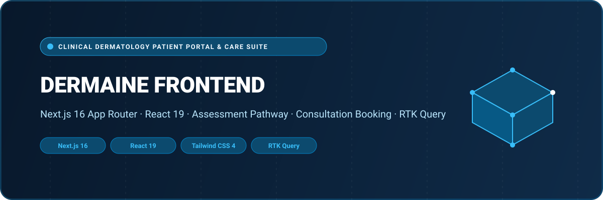

<div align="center">



# Dermaine Frontend — Clinical Patient Portal & Care Suite

An advanced, interactive patient portal and clinical assessment web application built for dermatology healthcare providers. Developed with **Next.js 16 (App Router)**, **React 19**, **Tailwind CSS 4**, **Radix UI**, and **Redux Toolkit (RTK Query)**.

[](https://nextjs.org/)
[](https://react.dev/)
[](https://tailwindcss.com/)
[](https://redux-toolkit.js.org/)
[](https://www.typescriptlang.org/)
[](LICENSE)

</div>

---

## 🌟 Overview

**Dermaine Frontend** serves as the primary patient and client-facing digital touchpoint for modern dermatology clinics. It delivers a streamlined, empathetic user journey from initial symptom inquiry and guided medical questionnaires to personalized treatment pathway discovery and certified dermatologist consultation booking.

Combined with [`dermaine_backend`](https://github.com/shahjalal-labs/dermaine_backend) (Prisma/PostgreSQL microservice API) and [`dermaine_dashboard`](https://github.com/shahjalal-labs/dermaine_dashboard) (clinic & doctor administration portal), it completes the comprehensive **Dermaine Healthcare Ecosystem**.

---

## 🚀 Key Features & Capabilities

- 📋 **Dynamic Clinical Assessment Engine**: Multi-step interactive diagnostic questionnaires, intelligent condition categorization, and immediate health summary feedback.
- 🎯 **Pathway Matching & Eligibility**: Automated algorithms that align patient symptoms and dermatological requirements with specific care pathways and specialized practitioner teams.
- 📅 **Direct Consultation Booking**: Seamless calendar selection, time slot reservation, and appointment confirmation workflow.
- 🔐 **Patient Authentication & Onboarding**: Secure registration, email OTP verification, password reset flows, and cookie-persisted JWT session management.
- ⚡ **Next.js 16 & React 19 Performance**: Built on the latest Next.js App Router with React 19 concurrent features and React Compiler optimizations.
- 🎨 **Modern Design System**: Styled with Tailwind CSS v4, Radix UI accessible primitives, Shadcn components, and smooth animations powered by Framer Motion.
- 🔄 **Real-Time Data Layer**: RTK Query implementation for optimistic cache updates, automatic invalidation, and synchronized server state.

---

## 🏛️ System Architecture & Workflow

```
[ Patient / Client ]
        │
        ▼
[ Next.js 16 App Router UI ]
   ├── Authentication (Login, Register, OTP Verify)
   ├── Interactive Assessment Flow (Questionnaire & Scoring)
   ├── Pathway Matching Engine (Eligibility & Treatment Recommendations)
   └── Consultation Booking (Slot Selection & Appointment Dispatch)
        │
        ▼  (RTK Query Services / HTTPS REST)
[ Dermaine Backend API ] ──► [ PostgreSQL / Prisma ORM ]
        ▲
        │  (Administrative Supervision)
[ Dermaine Dashboard ]
```

---

## 📁 Repository Structure

```
dermaine_frontend/
├── assets/
│   └── banner.svg                  # Architectural SVG project banner
├── public/                         # Static assets, branding, and imagery
├── src/
│   ├── app/
│   │   ├── (auth)/                 # Patient authentication routes
│   │   │   ├── login/              # Secure patient sign-in
│   │   │   ├── register/           # Account registration
│   │   │   ├── verify-otp/         # Email verification via one-time passcode
│   │   │   ├── reset-password/     # Password recovery workflow
│   │   │   └── new-password/       # Password replacement confirmation
│   │   ├── (public)/               # Publicly accessible clinical pages
│   │   │   ├── assessment/         # Dynamic questionnaire & symptoms analysis
│   │   │   ├── pathway-matching/   # Algorithmic treatment matching
│   │   │   ├── pathways/           # Available dermatological care pathways
│   │   │   ├── book-consultation/  # Live doctor scheduling & appointment booking
│   │   │   ├── pricing/            # Treatment tiers and insurance options
│   │   │   └── resources/          # Medical guides and patient documentation
│   │   ├── layout.tsx              # Root HTML layout with Redux & Theme providers
│   │   └── globals.css             # Tailwind CSS 4 styling and theme tokens
│   ├── components/
│   │   ├── Assessment/             # Interactive questionnaire components & progress meters
│   │   ├── Auth/                   # Modular authentication cards & OTP input panels
│   │   ├── Home/                   # Hero sections, pathway previews, user reviews
│   │   ├── Shared/                 # Global navigation headers, footers, and modal wrappers
│   │   └── ui/                     # Accessible Shadcn & Radix UI atoms
│   ├── redux/
│   │   ├── api/                    # RTK Query service definitions (Auth, Assessment, User)
│   │   ├── hooks.ts                # Typed Redux useDispatch and useSelector hooks
│   │   └── store.ts                # Centralized state store with Redux Persist
│   ├── types/                      # TypeScript domain models and interface contracts
│   └── lib/                        # Formatting utilities, CN helper, and calculation logic
├── package.json                    # Project dependencies (Next.js 16, React 19, Tailwind 4)
└── tsconfig.json                   # Strict TypeScript compiler configuration
```

---

## 💻 Tech Stack Specification

| Domain | Selected Technologies |
| :--- | :--- |
| **Framework** | Next.js 16.2.9 (App Router, Turbopack) |
| **Runtime & React** | React 19.2.4 & React DOM 19 |
| **Language** | TypeScript 5 (Strict Mode) |
| **Styling** | Tailwind CSS 4, PostCSS, Tailwind-Merge |
| **UI Components** | Radix UI Primitives, Lucide Icons, React Icons |
| **State Management** | Redux Toolkit (RTK), RTK Query, Redux Persist |
| **Forms & Validation** | React Hook Form, Zod 4 Resolver |
| **Motion & UX** | Framer Motion, AOS (Animate on Scroll), Embla Carousel |
| **Session & Auth** | JS Cookie, JWT Storage |

---

## 🛠️ Getting Started & Local Development

### Prerequisites

- **Node.js**: `v20.x` or higher
- **Package Manager**: `npm`, `yarn`, or `pnpm`

### 1. Clone the Repository

```bash
git clone https://github.com/shahjalal-labs/dermaine_frontend.git
cd dermaine_frontend
```

### 2. Install Dependencies

```bash
npm install
```

### 3. Configure Environment Variables

Create a `.env.local` file in the root directory:

```env
NEXT_PUBLIC_BASE_URL_LOCAL=http://localhost:5000/api/v1
```

### 4. Run Development Server

```bash
npm run dev
```

Open [http://localhost:3000](http://localhost:3000) in your browser to view the patient portal.

---

## 👨‍💻 Engineering & Authorship

Developed and engineered by **Md. Shahjalal**.

- **GitHub**: [@shahjalal-labs](https://github.com/shahjalal-labs)
- **Email**: [muhommodshahjalal@gmail.com](mailto:muhommodshahjalal@gmail.com)

---

## 📄 License

This project is open-source and available under the [ISC License](LICENSE).
